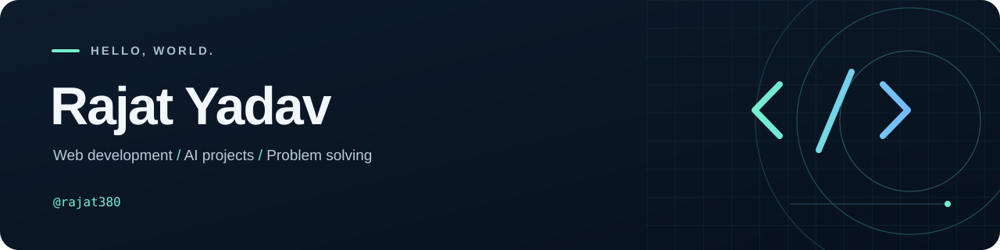

  

  <a href="#about-me">About</a> &nbsp; / &nbsp;
  <a href="#projects">Projects</a> &nbsp; / &nbsp;
  <a href="#my-toolkit">Toolkit</a> &nbsp; / &nbsp;
  <a href="https://github.com/rajat380?tab=repositories">All repositories ↗</a>

## About me

Hi, I'm **Rajat Yadav**. I enjoy building web applications, exploring practical uses of AI, and solving problems with **C++**.

This is where I share my projects and coding practice—from React interfaces and backend APIs to data structures and algorithms.

- **Web development:** working with React, Node.js, Express and MongoDB.
- **AI exploration:** learning how generative AI can support useful applications.
- **Problem solving:** practising DSA through LeetCode solutions in C++.

## Projects

### [Resume-GENAI ↗](https://github.com/rajat380/Resume-GENAI)

An AI-powered resume analysis and interview preparation application. It compares a resume with a job description, identifies skill gaps, and generates interview questions and a preparation plan.

`React` `Node.js` `Express` `MongoDB` `Google Gemini`

### [LeetCode Questions ↗](https://github.com/rajat380/Leetcode-Questions)

My collection of C++ solutions, covering arrays, strings, linked lists, trees, binary search and dynamic programming.

`C++` `Data Structures` `Algorithms` `Problem Solving`

### [Portfolio ↗](https://github.com/rajat380/Portfolio)

A personal portfolio presenting my interests, skills and projects through a responsive web interface.

`HTML` `CSS` `JavaScript` `Responsive Design`

## My toolkit

| Area | Technologies |
| :--- | :--- |
| Languages | C++ · JavaScript · Python |
| Frontend | React · HTML · CSS · Sass · Vite |
| Backend & data | Node.js · Express · MongoDB |
| AI & development tools | Google Gemini API · Git · GitHub · VS Code |

## What I'm exploring

Building complete web applications, connecting AI features to real workflows, and improving my understanding of data structures and algorithms through consistent practice.

---

  <strong>Build something useful. Understand how it works. Keep improving.</strong> 
  Thanks for stopping by. Explore the repositories to see what I'm working on.

